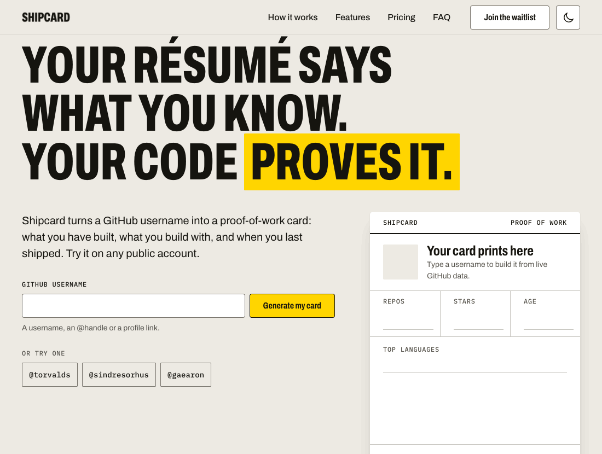

# Shipcard

A React landing page whose hero is a working demo: type a GitHub username and get a proof-of-work card built live from GitHub's public API.

**Live:** https://shipcard.fran64biz.workers.dev · try [`?u=torvalds`](https://shipcard.fran64biz.workers.dev/?u=torvalds)



Shipcard is a fictional product built for a senior engineering assessment. The page is real: the demo calls GitHub, the waitlist stores sign-ups, and everything below describes what is in this repository.

## Features

- **Live proof-of-work card.** Avatar, name, handle and account age; public repositories and total stars; top five languages by repository; the three most-starred repositories, linked; and how long ago the account last pushed.
- **Every state designed.** The card has an empty state, a loading state and a specific message and recovery action for each failure: no such user, GitHub's hourly limit (with the local reset time and saved example cards), a secondary limit, a timeout, no network, and an unexpected response.
- **Shareable cards.** A successful lookup puts `?u=<username>` in the address; opening that address loads the card. A copy-link button confirms in text.
- **One landing page.** Header, hero, how it works, features, pricing with a monthly/annual choice, FAQ, a waitlist form that really submits, and a footer.
- **Light and dark themes.** The system setting by default, the visitor's choice once made, remembered, and applied before first paint so nothing flashes.
- **Accessible throughout.** Landmarks, one `h1`, a skip link, visible focus, 44 px touch targets, a keyboard-operable menu, forms that announce their errors, and motion that respects `prefers-reduced-motion`.

## Tech stack

| Tool                                                   | Why                                                                                                                                                                                                                 |
| ------------------------------------------------------ | ------------------------------------------------------------------------------------------------------------------------------------------------------------------------------------------------------------------- |
| React 19                                               | Required by the brief.                                                                                                                                                                                              |
| JavaScript with JSDoc types, checked by `tsc --noEmit` | The brief says JavaScript; `checkJs` still catches type errors in CI ([ADR 0003](docs/decisions/0003-javascript-with-jsdoc-types.md)).                                                                              |
| Vite 8                                                 | A dev server and a bundler and nothing else, so every file here is ours to explain ([ADR 0002](docs/decisions/0002-vite-and-react.md)).                                                                             |
| CSS Modules and custom-property tokens                 | Scoped styles with no runtime; one token file is the design system ([ADR 0004](docs/decisions/0004-css-modules-and-design-tokens.md)).                                                                              |
| Vitest, React Testing Library, MSW                     | One config with the build; tests query by role; the real `fetch` code runs against intercepted requests ([ADR 0009](docs/decisions/0009-vitest-testing-library-and-msw.md)).                                        |
| Cloudflare Workers, static assets and KV               | One origin for the page and its one endpoint; security headers in the repository ([ADR 0012](docs/decisions/0012-host-on-cloudflare-workers.md), [ADR 0013](docs/decisions/0013-waitlist-endpoint-on-a-worker.md)). |
| ESLint, Prettier, knip, size-limit                     | Zero warnings, no formatting debates, no unused code or dependencies, and a 100 kB budget, all enforced in CI.                                                                                                      |

There is no state library, no animation library, no UI kit and no date library. The only runtime dependencies are `react` and `react-dom`.

## Getting started

**Prerequisites:** Node 24 (see `.nvmrc`) and npm.

```sh
git clone https://github.com/HorlaRepo/shipcard.git
cd shipcard
npm ci
npm run dev        # the page, at http://localhost:5173
```

There is no `.env` file: the project has no secrets and no environment variables. The demo talks to GitHub without credentials.

The waitlist form posts to `/api/waitlist`, which the Vite dev server forwards to the Worker. To run that too, in a second terminal:

```sh
npm run dev:api    # builds, then serves the page and the API with wrangler on :8787
```

| Script                            | What it does                                                                                    |
| --------------------------------- | ----------------------------------------------------------------------------------------------- |
| `npm run dev`                     | Vite dev server with hot reload.                                                                |
| `npm run dev:api`                 | Builds the page and runs the Worker locally (page and API on port 8787, with a local KV store). |
| `npm run build`                   | Production build into `dist/`.                                                                  |
| `npm run preview`                 | Serves the production build (page only).                                                        |
| `npm run lint`                    | ESLint, failing on any warning.                                                                 |
| `npm run format` / `format:check` | Prettier: write, or check without writing.                                                      |
| `npm run typecheck`               | `tsc --noEmit` over the JSDoc types.                                                            |
| `npm run knip`                    | Finds unused files, exports and dependencies.                                                   |
| `npm test` / `test:watch`         | The test suite, once or in watch mode.                                                          |
| `npm run test:coverage`           | The suite with a coverage report.                                                               |
| `npm run size`                    | Checks first-load JavaScript against the 100 kB budget (run after `build`).                     |
| `npm run check`                   | Everything CI runs, in the same order.                                                          |
| `npm run deploy`                  | Builds and deploys to Cloudflare (needs `wrangler login`).                                      |

## Project structure

```text
.
├── index.html               Metadata, structured data and the inline no-flash theme script
├── wrangler.jsonc           Cloudflare config: static assets, the Worker and its KV binding
├── public/                  Served as-is: fonts, icons, social image, robots.txt, sitemap.xml, _headers
├── worker/                  The backend: one Worker with one endpoint, POST /api/waitlist
├── src/
│   ├── main.jsx             Entry point: mounts the app and loads the global styles
│   ├── app/                 App.jsx (composes the page) and providers/ (ThemeProvider)
│   ├── content/site.js      Every word on the page; components receive copy as props
│   ├── components/
│   │   ├── ui/              Button, Container, Section, Icon, Disclosure, SegmentedControl, VisuallyHidden
│   │   └── layout/          Header, MobileNav, ThemeToggle, SkipLink, Footer
│   ├── sections/            Hero, HowItWorks, Features, Pricing, Faq, Waitlist: layout, composing the above
│   ├── features/
│   │   ├── proof-card/      The live demo: GitHub client, mapper, state machine, form, card and its states
│   │   └── waitlist/        The sign-up form and submitWaitlist(), the only code that knows the endpoint
│   ├── hooks/               useInView, useMediaQuery, useModalDialog, useUrlParam
│   ├── lib/                 No React: http (fetch + timeout + errors), cache, format, email, breakpoints
│   └── styles/              tokens.css (the design system), breakpoints.css, reset.css, global.css
├── tests/                   Test setup, MSW server and handlers, fixtures (trimmed real GitHub responses)
├── tools/og-image.html      Source of the social image
├── docs/
│   ├── BRIEF.md             The build brief, with the owner's amendments
│   ├── DESIGN.md            The visual direction and every token's purpose
│   ├── PROGRESS.md          What was done in each phase, the audit triage and known limitations
│   └── decisions/           Decision records (ADRs) and the decision log
└── .github/workflows/ci.yml Lint, format, types, unused code, tests, build, bundle size, audit
```

Rules the layout follows:

- `sections/` compose `components/` and `features/`. They hold layout and, at most, view state.
- A feature owns its state, API calls and tests, and exposes one component (`ProofCardDemo`, `WaitlistForm`). Nothing outside imports its internals.
- `lib/` has no React imports, so the request and mapping code can be tested and replaced on its own.
- Copy lives only in `content/site.js`. Renaming the product is one edit there.
- Imports name their file. There are no barrel `index.js` files.

## Technical decisions

Every decision is recorded with its reason and the alternatives that lost. Structural decisions are ADRs; small ones are rows in the [decision log](docs/decisions/README.md) (51 so far).

| ADR                                                                      | Decision                                                                | In short                                                                               |
| ------------------------------------------------------------------------ | ----------------------------------------------------------------------- | -------------------------------------------------------------------------------------- |
| [0001](docs/decisions/0001-record-decisions-as-adrs-and-a-log.md)        | Record decisions as ADRs plus a decision log                            | The code shows what was chosen, never what was rejected or why.                        |
| [0002](docs/decisions/0002-vite-and-react.md)                            | Vite and React on Node LTS                                              | One static page needs a bundler, not a framework's conventions.                        |
| [0003](docs/decisions/0003-javascript-with-jsdoc-types.md)               | JavaScript with JSDoc types, checked by `tsc`                           | Type safety without TypeScript files.                                                  |
| [0004](docs/decisions/0004-css-modules-and-design-tokens.md)             | CSS Modules with custom-property tokens                                 | Scoped, zero runtime, themes by swapping token values.                                 |
| [0005](docs/decisions/0005-state-reducer-context-and-url.md)             | A reducer for the demo, context for the theme, the URL for the username | The smallest tool for each job. TanStack Query is the named scale-up path.             |
| [0006](docs/decisions/0006-unauthenticated-github-rest-api.md)           | GitHub REST API, unauthenticated, two requests per lookup               | A token in a browser bundle is a leaked token.                                         |
| [0007](docs/decisions/0007-motion-with-css-and-intersection-observer.md) | Motion with CSS and IntersectionObserver                                | Every motion here is a change between two states; that costs no JavaScript.            |
| [0008](docs/decisions/0008-waitlist-submits-to-a-form-provider.md)       | Waitlist through a hosted form provider                                 | Superseded by 0013.                                                                    |
| [0009](docs/decisions/0009-vitest-testing-library-and-msw.md)            | Vitest, Testing Library and MSW                                         | The real client code runs in tests; only the network is replaced.                      |
| [0010](docs/decisions/0010-deploy-to-vercel-or-netlify.md)               | Deploy to Vercel or Netlify                                             | Superseded by 0012.                                                                    |
| [0011](docs/decisions/0011-skill-set-with-one-design-authority.md)       | A fixed skill set with one design authority                             | One voice per concern, so guidance cannot contradict itself.                           |
| [0012](docs/decisions/0012-host-on-cloudflare-workers.md)                | Host on Cloudflare Workers with static assets                           | The owner's instruction; one origin, headers in the repository.                        |
| [0013](docs/decisions/0013-waitlist-endpoint-on-a-worker.md)             | Waitlist endpoint on a Worker with KV                                   | A real submission with no third-party form vendor.                                     |
| [0014](docs/decisions/0014-render-on-the-client-without-prerendering.md) | Render on the client, without prerendering                              | LCP is 0.8 s without it; prerendering would add a hydration path for no measured gain. |

The visual decisions are in [`docs/DESIGN.md`](docs/DESIGN.md): the page is built on freight paperwork (label stock, condensed capitals, typewritten captions, one hi-vis yellow), chosen from seven recorded candidates.

## API integration

**Endpoints.** Each lookup makes two requests, in parallel and without credentials:

```text
GET https://api.github.com/users/{username}
GET https://api.github.com/users/{username}/repos?per_page=100&sort=pushed&type=owner
```

Both send `Accept: application/vnd.github+json` and `X-GitHub-Api-Version: 2026-03-10`.

**Before any request.** Input is trimmed, a leading `@` is dropped, and a pasted `github.com/<user>` link is reduced to the username. It must then match GitHub's own username rule; invalid input shows an inline error and never reaches the network. The username is `encodeURIComponent`-encoded in the path.

**Flow.**

```text
ProofCardForm (validate)
  → useGithubProfile (reducer: idle → loading → success | error)
    → cache hit? → success
    → githubClient.getProfile → lib/http.getJson × 2 (8 s timeout, AbortController)
    → mapProfile(user, repos, now) → view model → cache
  → ProofCard; address updated to ?u=<username>
```

A new lookup aborts the one in flight, and so does unmounting. An abort is never shown as an error.

**What counts.** Forks and archived repositories are left out of the stars, the languages and the top repositories: a fork's stars belong to its parent. The card says so. Totals come from the 100 most recently pushed repositories; when an account has more, the card says that instead. "Last shipped" reads the latest push across every repository, forks included.

**Rate limits.** GitHub allows 60 unauthenticated requests an hour per network address, so about 30 lookups. That is treated as a design constraint:

- Results are cached in memory and `sessionStorage` for 10 minutes, keyed by lowercase username. Storage failures (private mode, full quota) fall back to memory.
- The remaining allowance is read from GitHub's headers; when 10 or fewer requests are left, a hint under the form says how many lookups remain.
- When the limit is hit, the card's place shows the local time it resets and offers three saved example cards. They are real responses captured from the API, labelled "Snapshot from <date>", loaded on demand and mapped by the same `mapProfile`, so the fallback runs the real code.

**Error states.**

| Condition                              | Error                           | What the visitor sees                                                    |
| -------------------------------------- | ------------------------------- | ------------------------------------------------------------------------ |
| 404                                    | `NotFoundError`                 | "No GitHub user called @x", beside the input; focus returns to it        |
| 403 or 429 with no requests remaining  | `RateLimitError` with `resetAt` | The local reset time, and the example cards                              |
| Other 403 or 429                       | `RateLimitError` without a time | "GitHub is throttling requests…", and the example cards                  |
| No answer in 8 seconds                 | `TimeoutError`                  | A message and a retry button                                             |
| Request never arrived                  | `NetworkError`                  | An offline-aware message and a retry button                              |
| 5xx, non-JSON body or unexpected shape | `UpstreamError`                 | A generic message and a retry button; details logged in development only |

Avatars are accepted only from `avatars.githubusercontent.com` and requested at twice their rendered size. Links on the card are built from the login and repository name, so they can only point at github.com. All API data is rendered as text through React.

**The page's own API.** `POST /api/waitlist` takes `{ "email": "…" }` as JSON, validates the address again on the server, accepts same-origin requests only, and stores the lowercased address as a key in Workers KV, so signing up twice leaves one entry. It stores the address and the time, and nothing else.

## Accessibility, performance and SEO

**Measured on the deployed page** (mobile Lighthouse 13, simulated mid-range phone on slow 4G, three runs per theme, 21 November 2026):

| Theme | Performance | Accessibility | Best practices | SEO | LCP   | CLS | TBT      |
| ----- | ----------- | ------------- | -------------- | --- | ----- | --- | -------- |
| Light | 100         | 100           | 100            | 100 | 0.8 s | 0   | 50–70 ms |
| Dark  | 100         | 100           | 100            | 100 | 0.8 s | 0   | 70–90 ms |

axe-core, run in Chrome against the deployed page with a card loaded, an FAQ answer open and annual pricing selected: no violations in either theme at 390 px or 1280 px.

**Accessibility.** WCAG 2.2 AA is the target.

- Landmarks, one `h1`, headings in order, and a skip link as the first focusable element.
- A visible focus ring from a token on every control. Contrast for text, control edges and the focus ring is recorded in `DESIGN.md` and enforced by a test that reads the token file.
- The mobile menu is a modal dialog: focus moves in, Tab cycles inside, Escape closes it and returns focus, the page behind is inert.
- Forms have visible labels; errors are linked with `aria-describedby`, set `aria-invalid`, are announced, and return focus to the field. Demo results are announced through a live region that is marked busy while loading.
- Every link, button and input measures at least 44 × 44 px. No horizontal scroll from 320 px up.
- Colour never carries meaning alone, and every motion has a reduced-motion alternative.

**Performance.**

- First-load JavaScript is 83.5 kB gzipped against a 100 kB budget checked in CI. React and React DOM are 68 kB of it.
- Two self-hosted fonts, subset to 40 kB together; the one that sets the headline is preloaded.
- The card is printed on a frame of fixed size in every state, so nothing shifts when data arrives: the result region measures the same in all eight states.
- Only `transform` and `opacity` are animated. The header's scroll state comes from `IntersectionObserver`, not a scroll listener.
- Below-the-fold sections are not lazy-loaded: measured, it would save 1.5 kB (under 2%) for six more requests.

**SEO.** Title, description, canonical URL, Open Graph and Twitter tags, a 1200 × 630 social image, `SoftwareApplication` structured data whose offers match the pricing section, `robots.txt` and `sitemap.xml`. The page renders on the client; the reasoning and the measurements behind that are in [ADR 0014](docs/decisions/0014-render-on-the-client-without-prerendering.md).

**Security.** No secrets exist in the repository or the bundle. `public/_headers` sets a Content-Security-Policy starting from `default-src 'none'`, with no `unsafe-inline`: the one inline script is allowed by its hash, and a test fails if the two drift apart. It also sets `Referrer-Policy`, `X-Content-Type-Options`, `X-Frame-Options`, `Permissions-Policy`, `Cross-Origin-Opener-Policy` and HSTS. `npm audit` runs in CI at high severity.

## Testing

249 tests in two Vitest projects (the page in jsdom, the Worker in Node) run in about five seconds. Coverage is reported, not gated: 98% of statements, 94% of branches.

The suite tests behaviour that would embarrass the project if it broke, and queries the page the way a user or a screen reader finds things: by role and accessible name. Network calls are intercepted by MSW, so the real client code runs, and any request a test did not plan for fails that test. Fixtures are trimmed real GitHub responses.

| Area                      | What is covered                                                                                                                                  |
| ------------------------- | ------------------------------------------------------------------------------------------------------------------------------------------------ |
| `mapProfile`              | No repositories, all forks, missing languages, name and bio, very large star counts, language ordering, dates from an injected `now`, URL safety |
| Username parsing          | Valid and invalid names, `@handle`, pasted links, the 39-character limit, consecutive hyphens                                                    |
| `http` and `githubClient` | Every row of the error table, the timeout, cancellation, parallel requests, the pinned headers                                                   |
| `useGithubProfile`        | Each transition and error kind, a new lookup aborting the old, unmount aborting, cache hits and expiry                                           |
| Proof-card UI             | Submitting renders the card; each error and its recovery; the rate limit's reset time and example cards; the `?u=` deep link; copy link          |
| Waitlist                  | Validation on blur and submit, focus on the first error, success and each failure, retry                                                         |
| Worker                    | Storing, normalising, every rejection, the honeypot, cross-site posts, storage failure                                                           |
| Interactions              | Mobile menu and FAQ by keyboard (Enter, Space, Escape, Tab, focus return), the pricing choice                                                    |
| Theme                     | System default, toggling, persistence, blocked storage                                                                                           |
| Tokens and metadata       | Contrast ratios in both themes; the CSP hash, canonical address, structured-data prices and `theme-color` against their sources                  |
| Accessibility             | axe on the full page in both themes and with controls in non-default states                                                                      |

**Deliberately not tested here:**

- Visual styling, layout and motion. jsdom has no layout engine, so these were checked by eye and by script in a real browser (screenshots at 320, 390, 768 and 1280 px, target sizes, layout shift across states) and by Lighthouse.
- Cloudflare's KV and asset serving. The Worker is tested as a function with an in-memory store; the deployed endpoint was exercised once end to end.
- GitHub's API itself. Tests run against saved responses and never touch the network.
- Markup snapshots. They are brittle and nobody reviews them.

## Trade-offs and what I would do next

**Trade-offs made**

- **Totals stop at 100 repositories.** One page of results keeps a lookup at two requests. For the few accounts with more, stars and languages are understated, and the card says so.
- **The rate limit is per visitor network.** No token means no secret and no proxy to run, at the cost of about 30 lookups an hour. The cache and the example cards soften it; they do not remove it.
- **Client-side rendering.** Without JavaScript the visitor gets a `<noscript>` message, and crawlers that do not run scripts see metadata but not body copy (ADR 0014).
- **A hand-written request layer.** Caching, cancellation and error mapping are written and tested here because they are what is being assessed. A product would use TanStack Query (ADR 0005).
- **A fixed-size card.** It guarantees no layout shift, and costs an ellipsis on very long names.
- **The modal menu is a hook, not `<dialog>`.** jsdom cannot run `showModal()`, and the brief requires those behaviours to be tested (decision log L-13).
- **The waitlist is a small backend.** The brief first ruled one out; the owner's amendment brought it in. Addresses are unverified, and the endpoint relies on validation, a same-origin check and a honeypot.
- **Deploys are run by hand.** `npm run deploy` from `main`; CI does not hold Cloudflare credentials.

**With more time**

1. Paginate repositories for accounts over 100, behind a "count everything" action so the default stays at two requests.
2. Prerender the page at build time, once there is copy that needs to rank.
3. Add a small Playwright suite for what jsdom cannot see: focus order across the page, the theme script on first paint, and the card at each breakpoint.
4. Deploy from CI on merge to `main`, with a preview URL per pull request.
5. Double opt-in for the waitlist, and Turnstile if the endpoint is abused.
6. A custom domain, which is a change to three static files and one test.

Known limitations are listed in [`docs/PROGRESS.md`](docs/PROGRESS.md).

## Credits and licence

- Data: [GitHub REST API](https://docs.github.com/en/rest). Shipcard is not affiliated with GitHub.
- Type: [Archivo](https://github.com/Omnibus-Type/Archivo) by Omnibus-Type and [IBM Plex Mono](https://github.com/IBM/plex) by IBM, both under the SIL Open Font License 1.1 (licences in `public/fonts/`).
- Example cards are snapshots of public GitHub profiles, captured on 20 November 2026 and labelled as snapshots where shown.
- Design and interface guidance: the six skills listed in [ADR 0011](docs/decisions/0011-skill-set-with-one-design-authority.md), which are installed in this repository and pinned by `skills-lock.json`.

Code is released under the [MIT Licence](LICENSE).
